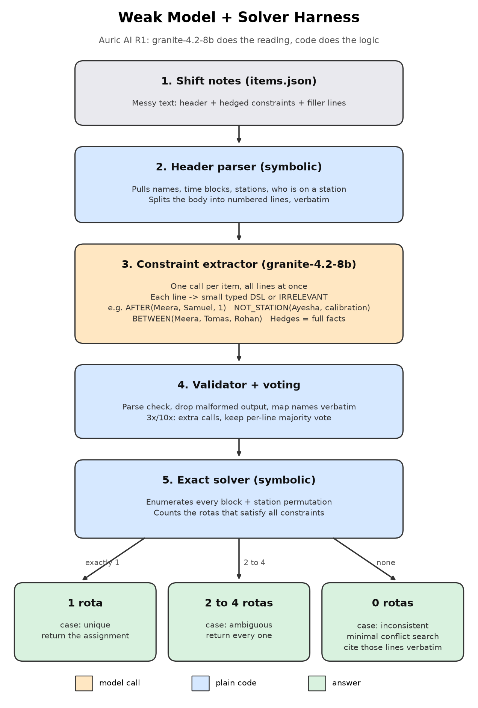
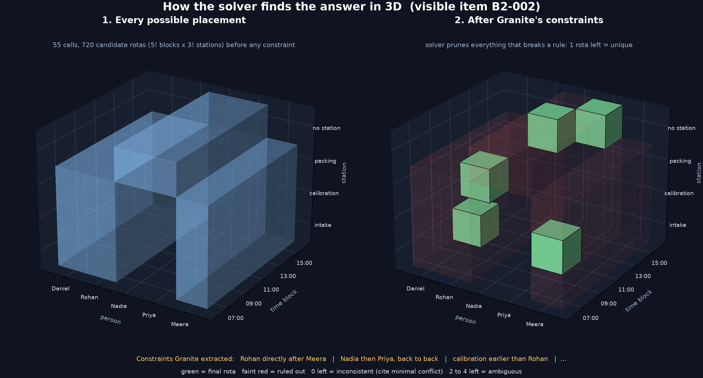

# Auric R1: a weak model as a translator, not a reasoner

Granite 4.2 8B scores 0.0% macro exact match on these items one-shot. This system
scores **0.739 at 1x, 0.806 at 3x, 0.861 at 10x** (macro exact match, visible set,
3 live runs each) with the same model, by giving it the one job it can do:
translate each note line into a small formal fact. Everything that needs
reasoning (search, counting solutions, finding the contradiction) is exact code.

```
./run data/items.json --budget 1x --out answers.json
python3 data/score.py data/visible_key.json answers.json
```

The full write-up is the [Write-up](#write-up) section of this README.

## Setup

- Python 3.11+ (tested on 3.12.15 and 3.11.7). Standard library only; `requirements.txt`
  pins nothing because nothing is imported from outside the stdlib.
- Put the endpoint credentials in `.env` at the repo root (same keys as the
  provided `.env`: `OPENROUTER_API_KEY`, and the base URL if given). `.env` is gitignored.
- Every call: `ibm-granite/granite-4.2-8b`, `temperature=1.0`, `top_p=0.95`,
  `reasoning: {enabled: false}`, header `X-Item-Id: <item id>`
  (`src/auric/client.py`). The per-item cap counts every HTTP attempt,
  retries included, so the proxy can never see more than the budget.

## Entry point

```
./run <items.json> --budget <1x|3x|10x> --out <answers.json>
      [--ablate prefilter,vote,prior_pick] [--enable adaptive]
      [--workers 8] [--trace traces.jsonl] [--log raw_replies.jsonl]
```

`1x` makes exactly one call per item; `3x`/`10x` make exactly 3/10 by default
(adaptive early stopping exists but is off; see the write-up for why).

## How it works



1. **Header, symbolic** (`parse.py`): people, blocks, stations and who holds a
   station are read from the item's fixed-format header.
2. **Prefilter** (`pipeline.py`): note lines that mention no person, block or
   station are dropped before the model sees them (pure token match on the
   header's own strings, so it does not depend on phrasing).
3. **Extraction, model-based** (`extract.py`): one call per sample sends all
   remaining lines; Granite answers `N | short rewrite | FACT` per line in an
   8-operator language (`AT, NOT_AT, ON, NOT_ON, BEFORE, JUST_BEFORE, BETWEEN,
   NONE`). A tolerant parser accepts its corrections and stray prose and
   validates every name/block/station against the header.
4. **Aggregation** (`pipeline.py`): per-line plurality vote across samples;
   then a structural-prior repair (ambiguous items have 2 to 4 rotas,
   contradictions need at least 3 lines) that tries the smallest change,
   preferring readings other samples gave.
5. **Exact solve and decide** (`solver.py`, `decide.py`): enumerate all
   5! x 3! = 720 rotas, keep the consistent ones. 1 => unique, 2+ => ambiguous
   (all of them), 0 => inconsistent, and a minimal unsatisfiable subset is
   found exactly and cited verbatim from the notes.



## Results (visible set, live endpoint)

| budget | runs | macro mean (min to max) | unique | ambiguous | inconsistent | calls/item | $/run |
|---|---|---|---|---|---|---|---|
| 1x | 3 | 0.739 (0.700 to 0.783) | 0.62 | 0.80 | 0.80 | 1.00 | 0.016 |
| 3x | 3 | 0.806 (0.800 to 0.817) | 0.67 | 0.92 | 0.83 | 3.00 | 0.047 |
| 10x | 3 | 0.861 (0.850 to 0.883) | 0.72 | 0.97 | 0.90 | 10.00 | 0.158 |

Ablations, confusion matrices and failure analysis: [README.md#write-up](README.md#write-up).

## Reproduce

```
python3 tests/test_solver.py          # 20 pure tests, no network
./dev/final_runs.sh main              # 3 live runs per budget -> results/final/
./dev/final_runs.sh all               # + live ablation runs
python3 dev/summarize.py              # markdown table from results/final/
python3 dev/build_pool.py 10 dev/pool.json   # 10 i.i.d. extraction samples per item
python3 dev/simulate.py dev/pool.json        # offline ablation replay over that pool
```

## Layout

```
run                     launcher
src/auric/solver.py     constraint model, exact enumeration, MUS search
src/auric/parse.py      header parser, line splitting
src/auric/extract.py    prompt + tolerant parser for the model's replies
src/auric/client.py     endpoint client, budget accounting
src/auric/pipeline.py   prefilter, vote, prior repair, (adaptive), run_item
src/auric/decide.py     unique/ambiguous/inconsistent + citations
src/auric/cli.py        argument handling, ablation switches
src/auric/regex_baseline.py  DEV ONLY: hand regexes for the visible phrasings,
                        used to check solver semantics (scores 1.00 with the
                        solver). Never used by ./run.
tests/test_solver.py    unit tests
dev/                    pool builder, offline simulator, line-error report, run scripts
results/final/          answers, scores, traces and logs of every reported run
```

## Write-up

**Headline (visible set, live endpoint, 3 runs per budget):** macro exact match
**0.739 at 1x** (0.700 to 0.783), **0.806 at 3x** (0.800 to 0.817),
**0.861 at 10x** (0.850 to 0.883). Bare Granite: 0.0. Cost per 60-item run:
$0.016, $0.047, $0.158.

**Constraint extraction is model-based.** Granite reads every note line and
writes the fact. The only symbolic parts are the item header (a fixed
"Staff / Blocks / Stations" format, not the notes) and a token prefilter that
drops lines naming nothing on the rota. No regex or keyword rule ever decides
what a note line means. A regex extractor I wrote for the visible phrasings
exists in `regex_baseline.py` purely as a semantics oracle (with the solver it
scores 1.00) and is never called by `./run`.

### 1. Characterising the model first

Before designing anything I asked what Granite 8B fails at, on these items:

- **Reasoning over a whole rota: hopeless.** 0.0 one-shot (brief's three
  runs). Search over 5 people x 5 blocks x 3 stations under ~15 constraints,
  plus counting solutions, is not something to ask of it at all.
- **Long structured output: fragile.** A JSON-per-line format broke on about
  20% of lines (unbalanced quotes, prose between objects, invented keys).
- **Short, local translation: decent.** Asked "what does this one sentence
  say?" it is right most of the time. That is the asymmetry the design rests on.
- **It does not obey "no other text".** It explains, apologises, writes a line
  twice and "corrects" it. So the parser must expect that rather than fight it.
- **Its errors are mostly omissions.** On 9,000+ line readings (pool v2) the
  per-line error rate is 5.1%: 55% are a real fact read as `NONE`, 35% a wrong
  fact, 10% unparseable. Omissions matter: one missed fact turns a unique item
  into an ambiguous one, which shows up in the confusion matrix below.
- **Sampling at T=1.0 is noisy but not systematically wrong** on most
  phrasings, so samples are worth voting over; on a few phrasings it is
  systematically wrong, and no number of samples fixes those (section 4).

### 2. Components, and why each exists

| component | why |
|---|---|
| exact solver + MUS (`solver.py`) | The model cannot count solutions or localise a contradiction; code can, exactly, in milliseconds (720 rotas). Gives "all rotas" for ambiguous and a provably minimal citation set for inconsistent. |
| infix fact language `N \| rewrite \| FACT` | Replaced JSON. The short "rewrite" column lets the model paraphrase first, which cut line errors from ~20% to ~10%; with the tolerant parser, ~5%. |
| tolerant parser | Takes the model's *last* well-formed reading per line, ignores prose, validates names/blocks/stations against the header. |
| prefilter | Fewer, shorter lines per call means less drift. Phrasing-independent: it only matches the header's own strings. |
| vote | Per-line plurality across samples removes the random part of the noise. |
| prior_pick (structural repair) | The brief guarantees 2 to 4 rotas when ambiguous and 3+ lines per conflict. When an extraction violates that, search the 1 to 2 smallest edits (prefer readings another sample gave; for a 2-line "contradiction", drop a line or flip an ordering fact) that make it plausible. Uses only the published priors, never the item's kind. |
| adaptive stopping | Built, kept as a switch, **off by default** (see 3). |

Few-shot examples use invented names, stations and phrasings that occur nowhere
in `items.json`, so the visible set acts as held-out data for the prompt.

### 3. Ablations

Each component off, all else default. Live = one full run per cell on the
endpoint (the "full" rows are the 3-run means above). Offline = replay of the
same aggregation code over a fixed pool of 10 i.i.d. extraction samples per item
(`dev/pool_v2.json`), averaged over 10 / 4 / 2 disjoint sample subsets at
1x / 3x / 10x. The offline numbers are lower-variance and are the ones to
compare components with; the live rows check they hold on the endpoint.

Live (macro exact match; "full" = mean of 3 runs, others 1 run each;
run-to-run spread of a single run is about +/-0.04 at 1x and +/-0.02 at 3x/10x):

| config | 1x | 3x | 10x | calls/item at 10x |
|---|---|---|---|---|
| full (default) | 0.739 | 0.806 | 0.861 | 10.00 |
| - prefilter | 0.717 | 0.817 | 0.850 | 10.00 |
| - vote | n/a (1 sample) | 0.833 | 0.867 | 10.00 |
| - prior_pick | 0.750 | 0.767 | 0.817 | 10.00 |
| + adaptive | n/a (1 call) | 0.850 (2.33 calls) | 0.800 | 2.75 |

Per-case rates, call counts and cost of every cell: `python3 dev/summarize.py`.

Offline replay (pool v2, macro exact match, calls/item in brackets):

| config | 1x | 3x | 10x |
|---|---|---|---|
| full (default) | 0.727 | 0.800 | 0.867 |
| - vote | 0.727 | 0.800 | 0.850 |
| - prior_pick | 0.728 | 0.775 | 0.825 |
| + adaptive | 0.727 | 0.796 (2.30) | 0.808 (2.84) |

What the ablations say, honestly:

- **The solver is the system.** Every number above is the solver's; without it
  (bare model) the score is 0.0.
- **prior_pick is the one aggregation component that clearly helps**:
  +2.5 / +4.2 points offline and +3.9 / +4.4 live at 3x / 10x, mostly on
  ambiguous items. At 1x it is neutral (0.739 vs 0.750, inside noise): with
  one reading per line it can only drop or flip lines of a too-small conflict.
- **vote does not earn its place.** Offline it adds 1.7 points at 10x and
  nothing at 3x; live, the no-vote runs were as good or better (0.833, 0.867).
  Without vote the system takes an answer-level majority over plausible
  candidates, which already captures most of the benefit. I left vote on
  because the offline replay, the lower-variance measurement, does not show
  it hurting; it is a fair candidate to remove.
- **prefilter is neutral within noise** (-2.2, +1.1, -1.1 points live). It
  stays because it cuts prompt tokens and keeps citations to relevant lines.
- **Built and removed: adaptive stopping.** Stop when two consecutive
  aggregates agree and are plausible. It saves 70% of calls at 10x and costs
  6 points offline (0.808 vs 0.867) and 6 live (0.800 vs 0.861). At 3x it is
  a wash (offline 0.796 vs 0.800; the live 0.850 is one run). It fails because agreement between samples is not evidence of correctness
  when the model is *systematically* wrong on a line: two samples making the
  same omission agree immediately. I kept the code behind `--enable adaptive`
  so the trade-off is re-runnable.
- **Also removed:** a JSON output schema (too fragile, section 1), and two
  prompt revisions (v3, v4) that added more few-shot examples for the worst
  phrasings. Both moved the targeted line errors but raised others; overall
  line error went 5.1% -> 5.9% and 5.4%, so I reverted to v2. More examples is
  not free for an 8B model: each one is also a pattern it can over-apply.

### 4. Where it breaks

Confusion matrices, summed over the 3 live runs (rows = true kind, 60 each):

| true \ declared | 1x: U / A / I | 3x: U / A / I | 10x: U / A / I |
|---|---|---|---|
| unique | 41 / 14 / 5 | 46 / 11 / 3 | 46 / 11 / 3 |
| ambiguous | 1 / 56 / 3 | 1 / 59 / 0 | 0 / 58 / 2 |
| inconsistent | 3 / 5 / 52 | 3 / 6 / 51 | 2 / 3 / 55 |

The dominant failure is **unique declared ambiguous**: an omitted fact leaves
2 to 4 rotas, which passes the structural prior, so nothing flags it. This is
the "failing honestly" direction: the formal representation is right, one
constraint is missing. The remaining non-diagonal mass is a wrong-direction
fact creating a spurious conflict, or a missed fact dissolving a real one.
Items declared correctly but with wrong content are rare at 3x and 10x
(`ambiguous_partial` 0.9 to 1.0).

The worst phrasings (line error over the pool): "X relieves Y directly, with no
block in between" (35%, always the direction reversed), "whoever drew the T
block, it was P" (38%, read as `NONE`), "there is no block between P's and
Q's, in that order" (30%), "P sits between Q and R on the rota" (22%, read as
`NONE`). The pattern: the model does fine on what a sentence asserts, worse on
**who comes first** when the surface order and the time order disagree, and it
discards sentences that open with a subordinate clause. These are systematic,
so voting cannot fix them and the curve flattens: 3x to 10x buys 5.5 points for
3.3x the calls. That plateau is the interesting part: past 3x the remaining
error is bias, not variance.

### 5. Different authors, not a template

The held-out set changes the phrasing, and real notes would change it more.
What transfers: the header, the solver, the MUS citations, the prefilter
(it only needs names that appear in the header), and all aggregation, none of
which look at wording. What is exposed: the extractor, which is exactly as good
as Granite's reading of a sentence it has not seen. Two things help it hold
up: the few-shot examples share no wording with the visible set, so the
visible scores already measure unseen phrasing for the prompt; and the
structural repair catches some misreadings regardless of wording. What would
break with human authors: facts split across two lines ("Rohan's on early.
Before Nadia, I mean."), pronouns, facts about a person by role only, names
written two ways ("Dan"/"Daniel"), and genuine conflicts that a human would
resolve by recency ("correction: ..."). My per-line design cannot see across
lines, and exact string matching would reject name variants.

### 6. With a month

1. **Direction as a separate question.** For every ordering fact, a second
   tiny call: "In the sentence, who works first, A or B?" Binary questions are
   where an 8B model is most reliable; this targets the largest bias.
2. **Omission check by contrast.** For lines read as `NONE` that mention 2+
   rota entities, ask "does this sentence tell us anything certain about the
   current rota? yes/no". Spend extra calls only there, and only at 3x+.
3. **Uncertainty-weighted MaxSAT** instead of plurality: weight each line's
   readings by agreement and choose the most likely consistent extraction
   under the priors, rather than repairing after the fact.
4. **Cross-line context** (coreference, corrections) and alias handling for
   human-written notes; a phrasing generator to test robustness before the
   held-out set does.

### Method notes

- 60 visible items only; no held-out access. All numbers are from
  `results/final/` and `results/offline_ablation_v2.txt`, regenerated by
  `dev/final_runs.sh` and `dev/simulate.py`.
- Development took about six hours of focused work; a frontier model helped
  write code and this text, never answered items.
